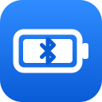
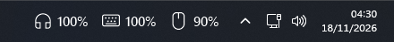

  

<h1 align="center">BtBattery</h1>

See the battery level of your Bluetooth headphones, mouse, keyboard and phone right on the Windows taskbar.

  

## Features

- Shows every connected Bluetooth device that reports its battery, with an icon for its type.
- Sits next to the system tray and grows or shrinks the moment devices connect and disconnect.
- Hover to see device names. Levels turn red at 20% or below.
- Sends a Windows notification when a device drops to 20%, and again at 10%.
- Choose which devices appear and in what order.
- Matches the taskbar's light or dark theme and your display scaling.
- Tiny and dependency-free: one small `.exe`, nothing to install.

## Get started

1. Download **`BtBattery.exe`** from the [latest release](https://github.com/NotYourGuy/BtBattery/releases/latest).
2. Put it somewhere you'll keep it, for example `Documents\BtBattery`.
3. Double-click it. If Windows SmartScreen warns about an unrecognized app, choose **More info → Run anyway**. This happens because the app isn't code-signed.

To start it automatically when you sign in, right-click the strip and choose **Start with Windows**.

### Build it yourself

Prefer to build from source? Download this repository, then double-click **`build.cmd`**. It builds `BtBattery.exe` with the C# compiler that comes with Windows, so there's nothing to install.

## Using it

| Action | What it does |
| --- | --- |
| Hover | Shows each device's name and battery level |
| Left-click | Checks the levels right away (they also update every 30 seconds, and instantly when a device connects or disconnects) |
| Right-click | **Refresh now**, **Devices** (show/hide and reorder each device), **Start with Windows**, **Low battery alerts** (on/off), **Exit** |

## Good to know

- Requires Windows 10 or 11.
- Only devices that report their battery to Windows appear. If a device shows a percentage in **Settings → Bluetooth & devices**, it will show here too.
- Levels come from Windows, which updates them every few minutes, so they can be slightly behind.
- To uninstall, untick **Start with Windows**, choose **Exit**, then delete the folder.

## License

[MIT](LICENSE) © Lucian Vasile
